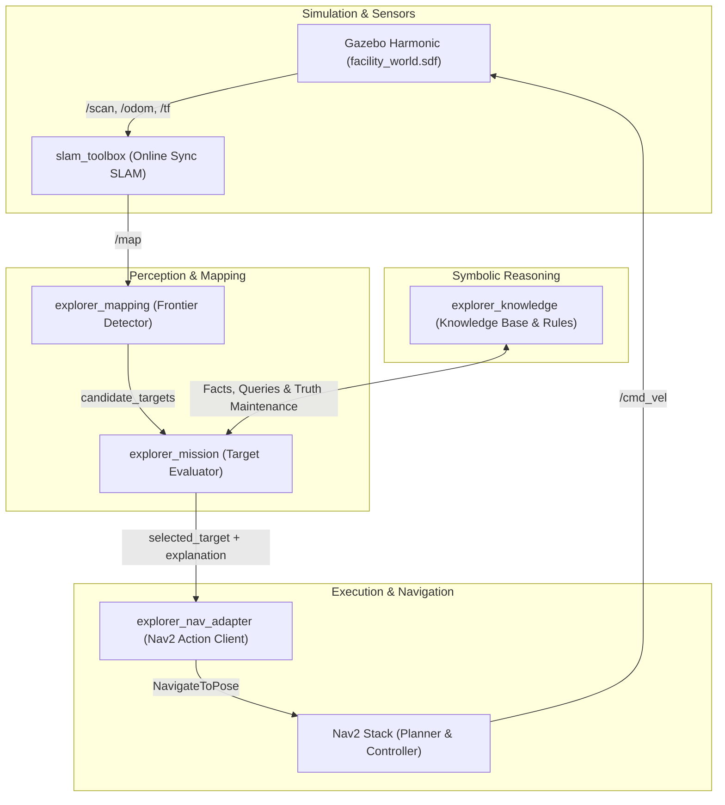

# System Architecture — Symbolic Autonomous Exploration and Mission Reasoning

## 1. Overview and Core Philosophy

**Symbolic Explorer** is an autonomous mobile robot research system combining online mapping, frontier-based geometric exploration, first-order symbolic reasoning, and Nav2 path execution.

A fundamental design requirement is **Unknown-World Integrity**:
- The agent has **no access** to ground-truth world models, hidden obstacle coordinates, or pre-built maps.
- All spatial awareness is constructed incrementally from simulated LiDAR range data via online SLAM.
- The epistemic status of information is explicitly tracked under the principle: **Unknown is not false**. The absence of a detected hazard does not prove that an uninspected area is safe.



---

## 2. Package Decomposition

| Package | Type | Primary Responsibilities |
|---|---|---|
| `explorer_interfaces` | `ament_cmake` | Custom ROS 2 IDL definitions: `SymbolicFact`, `ExplorationTarget`, `DecisionExplanation`, `MissionStatus`, `AddSymbolicFact`, `EvaluateFrontiers`, `ExecuteMission`. |
| `explorer_sim` | `ament_python` | Gazebo Harmonic 8 simulation assets: `facility_world.sdf`, lighting, physics, room partitions, restricted zones, obstacle pillars, TB3 waffle spawner, and ROS-GZ bridges. |
| `explorer_mapping` | `ament_python` | Online mapping bridge and pure Python `FrontierDetector`: boundary extraction, 8-connected component clustering, clearance inflation check, orientation calculation, and candidate deduplication. |
| `explorer_knowledge` | `ament_python` | First-order symbolic knowledge base, epistemic modalities (`OBSERVED`, `INFERRED`, `ASSUMED`, `UNKNOWN`), truth maintenance with dependency tracking, cascading retraction, and forward-chaining rule engine. |
| `explorer_mission` | `ament_python` | High-level mission coordinator: structured objectives, priorities, simulated resource proxy model, hard safety constraints, multi-criteria utility ranking, and traceable decision explanations. |
| `explorer_nav_adapter` | `ament_python` | Nav2 action client for `NavigateToPose`: goal dispatching, timeout tracking, recovery monitoring, cancellation, and debouncing. |
| `explorer_evaluation` | `ament_python` | Benchmark suite comparing 5 strategies across multiple seeds: Random Frontier, Nearest Frontier, Max Information Gain, Heuristic, and Full Symbolic Explorer. |
| `explorer_bringup` | `ament_python` | Unified launch files (`symbolic_explorer.launch.py`), runtime parameter configurations, and RViz layout. |

---

## 3. Epistemic Status and Rule Inference

### 3.1 Epistemic Modality
Every fact is represented as:
$$\text{Fact}(\text{predicate}, \text{arguments}, \text{confidence}, \text{source}, \text{timestamp}, \text{is\_negated}, \text{epistemic\_status})$$

Where `epistemic_status` is one of:
1. `OBSERVED`: Directly perceived by sensor modules (e.g. `FirstAidStationObserved(room_2)`).
2. `INFERRED`: Derived via forward-chaining deduction with recorded provenance.
3. `ASSUMED`: Prior mission assumptions or hypotheses subject to verification.
4. `UNKNOWN`: Open-world default; absence of a fact does not evaluate to falsehood.

### 3.2 Truth Maintenance and Provenance
When an observation is retracted or contradicted by higher-confidence data (e.g., `¬PassageClear(door_1)` replacing `PassageClear(door_1)`), all derived inferences dependent on the retracted premise are automatically revoked through dependency tracking.

---

## 4. Multi-Criteria Target Evaluation and Safety Constraints

### 4.1 Strict Hard Safety Constraints (Non-Negotiable)
Before scoring any candidate target, it must pass three strict filter gates:
1. **Restricted Zone Constraint**: Target coordinates must not lie inside any configured restricted keep-out polygon:
   $$(wx, wy) \notin \bigcup \text{RestrictedZone}_k$$
2. **Obstacle Clearance Constraint**: Target must provide at least robot radius + safety margin clearance from mapped obstacles:
   $$\text{clearance}(wx, wy) \ge d_{\text{min}}$$
3. **Resource Feasibility Constraint**: Robot must retain sufficient battery margin to travel to the target and subsequently return to the base station:
   $$E_{\text{rem}} - (E_{\text{to\_target}} + E_{\text{target\_to\_base}}) \ge E_{\text{reserve}}$$

### 4.2 Soft Multi-Criteria Utility Ranking
Candidates satisfying all hard constraints are ranked by the utility function:
$$U(q) = w_m M(q) + w_i I(q) - w_d D(q) - w_r R(q)$$

Where:
- $M(q) \in [0, 1]$: Relevance to active mission objective (e.g., proximity to unverified goal rooms).
- $I(q) \in [0, 1]$: Expected information gain (cluster size and boundary extent).
- $D(q) \in [0, 1]$: Normalized travel distance from the robot's current pose.
- $R(q) \in [0, 1]$: Estimated hazard risk derived from knowledge base predicates.

---

## 5. Traceable Explainability Schema

Every selected target outputs a structured explanation record:
```json
{
  "timestamp": 1791968136.99,
  "selected_target_id": 1,
  "selected_coords": [-0.65, -0.65],
  "mission_objective": "locate_first_aid",
  "scores": {
    "mission_relevance": 0.18,
    "information_gain": 1.00,
    "travel_cost": 0.92,
    "risk_estimate": 0.00,
    "total_utility": 0.180
  },
  "hard_constraint_results": [
    "PassedRestrictedZone",
    "PassedClearance",
    "PassedResourceFeasibility"
  ],
  "resource_feasibility": {
    "is_feasible": true,
    "battery_percent": 100.0
  },
  "supporting_facts": [],
  "inference_rules": ["R_MULTI_CRITERIA_UTILITY"],
  "rejected_alternatives": [
    {
      "target_id": 3,
      "coords": [3.0, 2.0],
      "reason": "HardConstraintViolation: inside restricted zone restricted_zone_alpha",
      "utility": -100.0
    }
  ],
  "selection_reason": "Selected Target 1 at (-0.65, -0.65) with utility=0.180. Satisfies all hard safety & resource constraints."
}
```